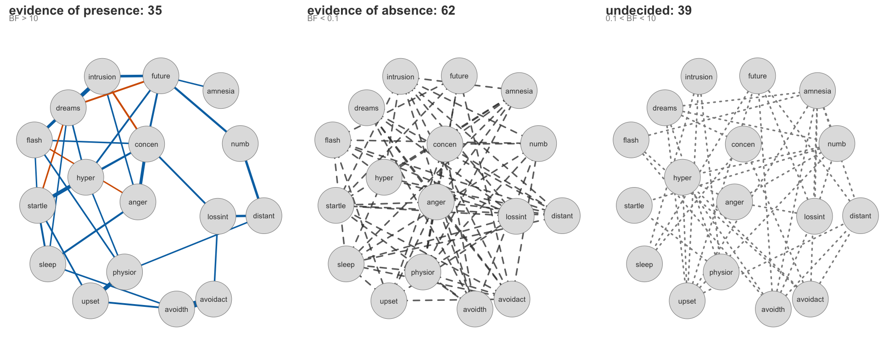

:::::: {.hero-banner}

::::: {.content-block .py-4}

:::: {.hero-text}
# bgms {.mt-1}

### Bayesian Graphical Models in R

- Estimate networks of mixed **binary**, **ordinal**, and **continuous** variables
- Use **Bayesian variable selection** to:
  - Quantify evidence for **including or excluding edges**
  - Detect **group differences** in network parameters 
- Discover **communities of related edges** with Bayesian edge clustering
- Fast posterior inference with:
  - **No-U-Turn sampler**
  - **Parallel multi-chain sampling**  
  - **C++ backend**

### Explore structure in your network with principled Bayesian inference.

::: {.grid .gap-3 .pb-3 .pt-4}
::: {.g-col-12 .g-col-sm-4}
[Getting started](examples/getting-started.qmd){.btn-action-primary .btn-action .btn .btn-lg .w-100 role="button"}
:::
::: {.g-col-12 .g-col-sm-4 .mb-2}
[Guide](guide/index.qmd){#btn-guide .btn-action .btn-secondary .btn .btn-lg .w-100 role="button"}
:::
::: {.g-col-12 .g-col-sm-4 .mb-2}
[Examples](examples/index.qmd){#btn-examples .btn-action .btn-secondary .btn .btn-lg .w-100 role="button"}
:::
:::

::::

::: {.hero-animation}
{width="250px"}
:::

:::::

::::::

:::::: {.alt-background}
::::: {.content-block .quick-start}

```r
# Install from CRAN
install.packages("bgms")

# Fit an ordinal Markov random field to the Wenchuan earthquake data
library(bgms)
data(Wenchuan)
fit = bgm(Wenchuan)
summary(fit)
```

The same fit weighs every possible edge and reports the evidence:

{.img-fluid fig-alt="Three network panels on one shared layout: evidence of presence (35 edges, weighted), evidence of absence (62, dashed), undecided (39, dotted)."}

Of the 136 possible edges, 35 are supported, 62 are ruled out, and 39
are undecided: the split an estimated network cannot make.
[See the full analysis →](examples/estimation-to-evidence.qmd)

Four pages take you from installation to a reported analysis.

1. [Getting started](examples/getting-started.qmd): install `bgms`, fit
   your first model, and read the network split by evidence.
2. [From estimation to evidence](examples/estimation-to-evidence.qmd): the
   full Wenchuan network, estimated first and then weighed pair by pair with
   an inclusion Bayes factor.
3. [Reading the output](examples/reading-the-output.qmd): the `summary()`
   of a real fit, walked block by block.
4. [Check your priors](examples/check-your-priors.qmd):
   [`prior_sensitivity_check()`](reference/prior-sensitivity.qmd) run on a
   fitted model, with its report and its curve read in full.

After that: [comparing groups](examples/comparing-groups.qmd), [edge
clustering](examples/edge-clustering.qmd), and [your bootnet and
qgraph workflow translated](examples/from-bootnet-qgraph.qmd).

The [Guide](guide/index.qmd) carries the reasoning behind these pages and the [Reference](reference/index.qmd) the function contracts.

:::::
::::::

:::::: {.get-started .alt-background}
::::: {.content-block}

### Citation

If you use `bgms` in your research, please cite the software package.

Choose a citation format (version is set to the documented release):

```{r}
#| echo: false
#| results: asis
# The version this build documents, read from the installed bgms rather than
# written down here; see scripts/doc-build.R. The page is not frozen, so the
# release build and the development build each print their own.
source("scripts/doc-build.R")
bgms_doc_version = doc_version()

cat(sprintf('<div class="citation-picker" data-cite-picker="bgms">

<div class="citation-picker-tabs" role="tablist" aria-label="Citation format">
<button class="citation-tab is-active" type="button" data-citation-tab="apa" role="tab" aria-selected="true">APA</button>
<button class="citation-tab" type="button" data-citation-tab="chicago" role="tab" aria-selected="false">Chicago</button>
<button class="citation-tab" type="button" data-citation-tab="bibtex" role="tab" aria-selected="false">BibTeX</button>
<button class="citation-tab" type="button" data-citation-tab="ris" role="tab" aria-selected="false">RIS</button>
</div>

<div class="citation-panel is-active" data-citation-panel="apa" role="tabpanel">
Marsman, M., & van den Bergh, D. (2026). bgms: Bayesian analysis of graphical
models (R package, version %s). https://CRAN.R-project.org/package=bgms
</div>

<div class="citation-panel" data-citation-panel="chicago" role="tabpanel" hidden="hidden">
Marsman, Maarten, and Don van den Bergh. 2026. bgms: Bayesian Analysis of
Graphical Models. R package, version %s.
https://CRAN.R-project.org/package=bgms.
</div>

<div class="citation-panel" data-citation-panel="bibtex" role="tabpanel" hidden="hidden">
<pre><code class="language-bibtex">
@Manual{bgms-package,
  title   = {bgms: Bayesian Analysis of Graphical Models},
  author  = {Marsman, Maarten and van den Bergh, Don},
  year    = {2026},
  note    = {R package version %s},
  url     = {https://CRAN.R-project.org/package=bgms}
}
</code></pre>
</div>

<div class="citation-panel" data-citation-panel="ris" role="tabpanel" hidden="hidden">
<pre><code class="language-text">
TY  - COMP
TI  - bgms: Bayesian Analysis of Graphical Models
AU  - Marsman, Maarten
AU  - van den Bergh, Don
PY  - 2026
N1  - R package version %s
UR  - https://CRAN.R-project.org/package=bgms
ER  -
</code></pre>
</div>

</div>
', bgms_doc_version, bgms_doc_version, bgms_doc_version, bgms_doc_version))
```

To generate citations directly from your installed package in R:

```r
citation("bgms")
toBibtex(citation("bgms"))
```

### The science

The tutorial developing this workflow end to end is in preparation.
The methods are published:
[Marsman, van den Bergh and Haslbeck (2025)](https://doi.org/10.1017/psy.2024.4)
on the ordinal Markov random field,
[Marsman et al. (2022)](https://doi.org/10.1007/s11336-022-09848-8) on
Bayesian edge screening and structure selection,
[Sekulovski et al. (2024)](https://doi.org/10.1080/00273171.2024.2345915)
on testing conditional independence,
[Marsman, Waldorp, Sekulovski and Haslbeck (2025)](https://doi.org/10.1017/psy.2025.10060)
on Bayes factor tests for group differences,
[Sekulovski et al. (2026)](https://doi.org/10.1037/met0000847) on the
stochastic block prior for clustering, and
[Huth et al. (2026)](https://doi.org/10.1038/s41562-025-02314-2) on how
often published network edges rest on inconclusive evidence.
The companion [reporting guidelines](https://doi.org/10.31234/osf.io/xce7j_v1)
by Sekulovski et al. (2026) say what to report and how.

**2026-08-04**: `bgms` 0.2.0.0 is on CRAN. [News →](news.qmd)

:::::
::::::
